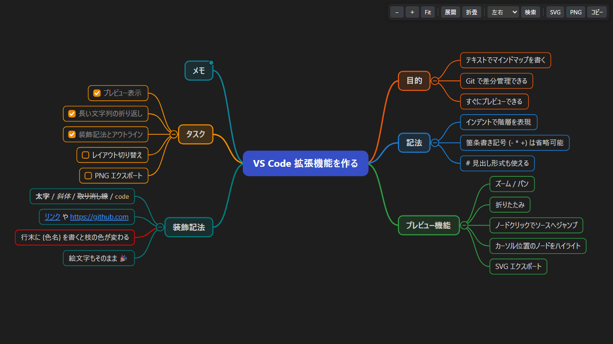
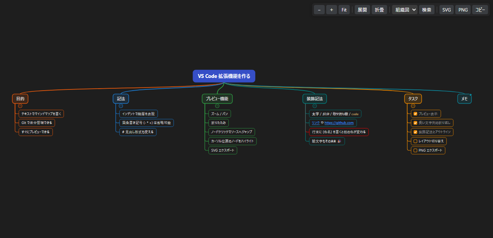
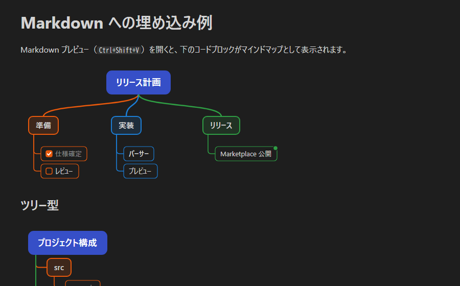

# Text Mindmap

[English](README.md) | 日本語

テキストで書いたマインドマップを VS Code 上でプレビューする拡張機能です。インデントで書くだけで、Git で差分管理しながらマインドマップを作れます。



## 主な機能

- インデント（または Markdown の見出し・箇条書き）で書くシンプルな記法
- ズーム・パン・折りたたみ、ノードクリックでソースへジャンプ
- 4 種類のレイアウト（左右・右・組織図・ツリー）
- 太字・リンク・チェックボックス・枝の色などの装飾、ノードのメモ
- フォーカス（枝だけ表示）と検索
- SVG / PNG 書き出し、画像のクリップボードコピー
- Markdown プレビューへの埋め込み、HTML への書き出し



## 記法（`.mindmap` ファイル）

```
// layout: both
中心テーマ
  - 枝 A
    - 葉 A-1
    > 葉 A-1 のメモ
    - 葉 A-2
  - 枝 B {teal}
    葉 B-1        ← 箇条書き記号は省略可
```

- インデント（スペース・タブ・全角スペース）の深さで親子関係を表します
- 行頭の `-` `*` `+` `1.` は省略できます
- `# 見出し` 形式も使えます。見出しの下の箇条書きは、その見出しの子になります
- `//` で始まる行はコメントです
- `>` で始まる行は、直前のノードのメモになります（複数行可）。プレビューではノード右上に印が付き、ホバーで表示されます
- `// layout: down` のように書くと、そのファイルのレイアウトを指定できます（`both` / `right` / `down` / `tree`）
- トップレベルの項目が複数ある場合は、ファイル名がルートになります

### 装飾記法

| 書き方 | 表示 |
| --- | --- |
| `**太字**` / `*斜体*` / `~~取り消し線~~` / `` `code` `` | 文字装飾 |
| `[テキスト](https://...)` / `https://...` | クリックできるリンク（相対パスならファイルを開く） |
| 行頭の `[ ]` / `[x]` | チェックボックス（プレビューでクリックすると切り替わる） |
| 行末の `{red}` / `{#e03131}` | そのノードと子孫の枝の色 |

## レイアウト

| 値 | 形 |
| --- | --- |
| `both` | ルートの左右に広がる（既定） |
| `right` | 右側だけに広がる |
| `down` | 上から下へ広がる組織図型（葉だけの枝は縦に並ぶ） |
| `tree` | エクスプローラーのような字下げツリー |

プレビューのツールバーで一時的に切り替えることもできます。

## Markdown への埋め込み

Markdown ファイルに ` ```mindmap ` のコードブロックを書くと、VS Code 標準の Markdown プレビューでマインドマップとして表示されます。



````markdown
```mindmap
// layout: down
リリース計画
  - 準備
  - 実装
```
````

### HTML への書き出し

Markdown を、マインドマップ入りの単体 HTML ファイルとして書き出せます。

- Markdown プレビューのタイトルバーにある書き出しアイコン
- エディタタブ・エクスプローラーの右クリックメニュー
- コマンドパレットの `Mindmap: Export Markdown as HTML`

変換には VS Code 標準の Markdown エンジンを使うので、見た目はプレビューとほぼ同じです。描画用のスクリプトと CSS は HTML に埋め込まれるため、ファイル 1 つで表示できます（ブラウザのダークモードにも対応）。

ローカルの画像（相対パス・`/` 始まりのワークスペースルートからのパス・絶対パス）も HTML に埋め込まれます。`https://` の画像はそのまま参照し、見つからない画像はパスのまま残して警告を表示します。埋め込みたくない場合は設定 `mindmap.export.embedImages` をオフにしてください。

## アウトライン

ノードの階層が VS Code の「アウトライン」パネルとパンくずリストに表示されます。

## プレビューの操作

| 操作 | 方法 |
| --- | --- |
| プレビューを横に開く | エディタ右上のプレビューアイコン / `Ctrl+K V` |
| プレビューを開く | コマンドパレットで `Mindmap: Open Preview` |
| ズーム | マウスホイール / `+` `-` |
| 移動 | ドラッグ |
| 全体表示 | `Fit` ボタン / `F` |
| 折りたたみ | ノード横の ○ をクリック |
| ソースへジャンプ | ノードをクリック |
| フォーカス（その枝だけ表示） | ノードをダブルクリック。左上のパンくずか `Esc` で戻る |
| 検索 | `検索` ボタン / `Ctrl+F`。`Enter` / `Shift+Enter` で次・前へ |
| 画像として保存 | `SVG` / `PNG` ボタン |
| 画像をコピー | `コピー` ボタン（PNG としてクリップボードへ） |

コマンドパレットから実行すれば、Markdown など他の形式のファイルもプレビューできます。

## 設定

- `mindmap.layout`: 既定のレイアウト（`both` / `right` / `down` / `tree`）
- `mindmap.maxNodeWidth`: ノードの最大幅（px）。超えると折り返します（既定 240）
- `mindmap.export.embedImages`: HTML 書き出し時にローカル画像を埋め込むか（既定 オン）

## 開発

```sh
npm test             # パーサーのテスト
```

拡張機能を読み込んだウィンドウで試すには:

```sh
code --extensionDevelopmentPath=. examples
```

パッケージ化: `npm run package`（`@vscode/vsce` を使います）

## ライセンス

[MIT](LICENSE)
