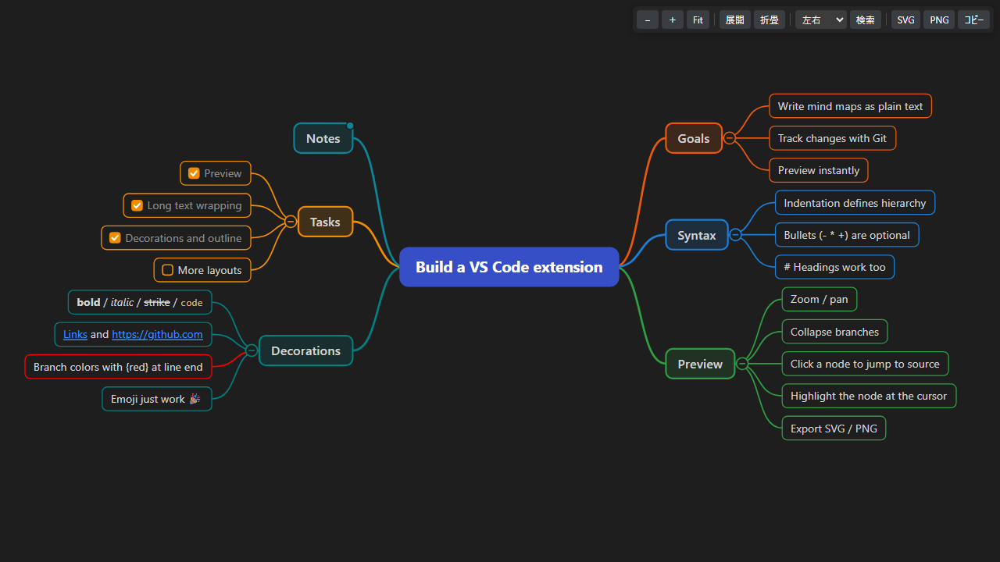
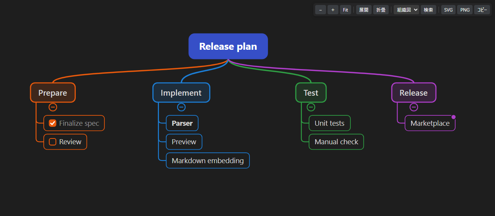
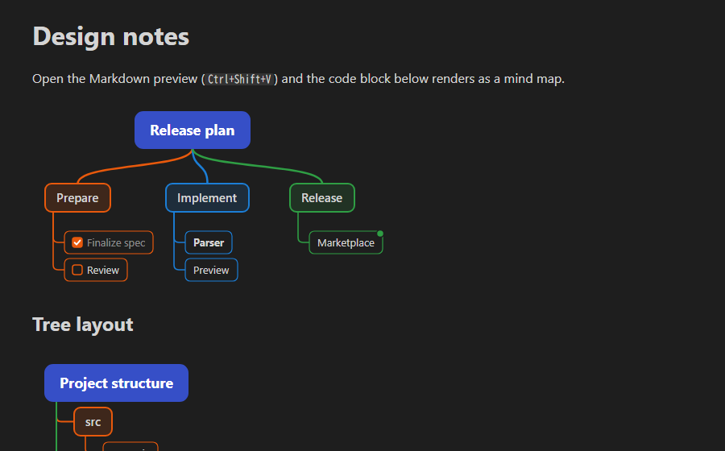

# Text Mindmap

English | [日本語](README.ja.md)

Write mind maps as plain text and preview them in VS Code. Just indent your ideas — the result is a diff-friendly file you can keep in Git.



## Features

- Simple syntax: indentation (or Markdown headings and lists) defines the tree
- Zoom, pan and collapse branches; click a node to jump to its line
- Four layouts: both sides, right only, org chart and tree
- Inline decorations (bold, links, checkboxes, branch colors) and notes on nodes
- Focus on a single branch and search across the map
- Export to SVG / PNG, or copy the image to the clipboard
- Embed mind maps in the Markdown preview and export Markdown to HTML
- Outline view and breadcrumbs



## Syntax (`.mindmap` files)

```
// layout: both
Central topic
  - Branch A
    - Leaf A-1
    > A note for leaf A-1
    - Leaf A-2
  - Branch B {teal}
    Leaf B-1        ← bullets are optional
```

- Indentation (spaces, tabs or full-width spaces) defines parent–child relationships
- Leading `-`, `*`, `+` or `1.` markers are optional
- `# Headings` also work; list items below a heading become its children
- Lines starting with `//` are comments
- Lines starting with `>` become a note on the node above (multiple lines allowed). Nodes with notes get a dot in the corner, and the note appears on hover
- `// layout: down` sets the layout for that file (`both` / `right` / `down` / `tree`)
- If there is more than one top-level item, the file name becomes the root

### Decorations

| Syntax | Result |
| --- | --- |
| `**bold**` / `*italic*` / `~~strike~~` / `` `code` `` | Text styles |
| `[text](https://...)` / `https://...` | Clickable links (relative paths open the file in VS Code) |
| `[ ]` / `[x]` at the start of a line | Checkbox — click it in the preview to toggle |
| `{red}` / `{#e03131}` at the end of a line | Color of that node and its branch |

## Layouts

| Value | Shape |
| --- | --- |
| `both` | Branches spread to the left and right of the root (default) |
| `right` | All branches on the right |
| `down` | Top-down org chart (branches with only leaves are stacked vertically) |
| `tree` | Indented tree, like a file explorer |

You can also switch layouts temporarily from the preview toolbar.

## Markdown integration

### Embedding in the Markdown preview

Write a ` ```mindmap ` code block in any Markdown file and VS Code's built-in Markdown preview renders it as a mind map.



````markdown
```mindmap
// layout: down
Release plan
  - Prepare
  - Implement
```
````

### Exporting Markdown to HTML

Export a Markdown file to a single, self-contained HTML file — mind maps included. Run it from:

- the export icon in the Markdown preview's title bar
- the context menu of an editor tab or the Explorer
- the Command Palette: `Mindmap: Export Markdown as HTML`

The conversion uses VS Code's own Markdown engine, so the output looks just like the preview. Scripts and styles are embedded, so the file works on its own (and follows the browser's dark mode).

Local images — relative paths, workspace-root paths starting with `/`, and absolute paths — are embedded into the HTML as well. `https://` images are referenced as-is; missing images are left as paths and reported in a warning. Turn off `mindmap.export.embedImages` to keep image paths instead.

## Outline

The node hierarchy appears in VS Code's Outline view and in the breadcrumbs.

## Preview controls

| Action | How |
| --- | --- |
| Open preview to the side | Preview icon in the editor title bar / `Ctrl+K V` |
| Open preview | Command Palette: `Mindmap: Open Preview` |
| Zoom | Mouse wheel / `+` `-` |
| Pan | Drag |
| Fit to window | `Fit` button / `F` |
| Collapse / expand | Click the ○ next to a node |
| Jump to source | Click a node |
| Focus on a branch | Double-click a node; go back with the breadcrumbs or `Esc` |
| Search | Search button (`検索`) / `Ctrl+F`; `Enter` / `Shift+Enter` for next / previous |
| Save as image | `SVG` / `PNG` buttons |
| Copy image | Copy button (`コピー`) — copies a PNG to the clipboard |

Run the command from the Command Palette to preview other file types, such as Markdown, as a mind map.

> The preview toolbar labels are currently in Japanese.

## Settings

- `mindmap.layout`: default layout (`both` / `right` / `down` / `tree`)
- `mindmap.maxNodeWidth`: maximum node width in pixels; longer text wraps (default `240`)
- `mindmap.export.embedImages`: embed local images when exporting Markdown to HTML (default `true`)

## Development

```sh
npm test             # parser tests
```

To try the extension in a new window:

```sh
code --extensionDevelopmentPath=. examples
```

Package with `npm run package` (uses `@vscode/vsce`).

## License

[MIT](LICENSE)
